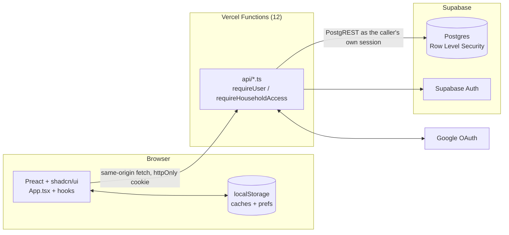
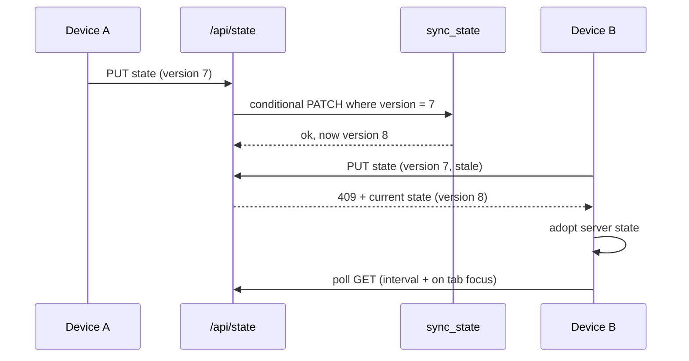
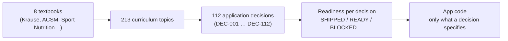

# Grocery

**A shopping-list, meal-planning and nutrition app for Turkish households, with nutrition logic
traced back to university textbooks.**

[](https://grocery-five-ecru.vercel.app)


The UI is in Turkish. The code, docs and commit history are in English. Sign-in is with Google.

**Contents:** [What it does](#what-it-does) · [Architecture](#architecture) ·
[Engineering decisions](#engineering-decisions) · [Nutrition backbone](#the-nutrition-backbone) ·
[How it is built](#how-it-is-built) · [Run it locally](#run-it-locally) · [Repository map](#repository-map)

---

## What it does

Five sections, one per tab:

| Section | What the user gets |
| --- | --- |
| **Alışveriş** (shopping) | A shared household list that syncs across devices. Items are sorted into store aisles automatically, autocomplete comes from everything bought before, and a finished list moves to History. |
| **Besin Değerleri** (nutrition) | A searchable food catalog with macros per 100 g, and side-by-side food comparison. |
| **Yemek Planı** (meal plan) | A day plan by meal slot, with a daily macro summary, ready-made meals, the user's own saved meals and recipes, "fits you" suggestions, and undo. |
| **Kişisel Plan** (personal plan) | Profile-based energy and macro targets, each feature linked to its scientific source. |
| **Ayarlar** (settings) | Households and invites, categories, theme, account deletion. |

<details>
<summary><b>Feature details</b></summary>

- **Households.** A user can own several households and invite others into them. Every list,
  meal entry and category memory is scoped to a household. Personal targets and saved meals are
  scoped to the user.
- **Turkish categorization.** A new item is placed in an aisle in three steps. First, a correction
  the household made earlier for that name. Then the built-in taxonomy, which uses Snowball Turkish
  stemming, keyword lists and a head-noun fallback for compounds like *chia tohumu*. Finally the
  user's own renamed, hidden or custom categories. Corrections sync between devices; automatic
  guesses don't, so a better classifier fixes old items without a data migration.
- **Meal planning.** Meals are added per slot from three sources: the user's saved meals
  (Yemeklerim), curated ready-made meals (Hazır Yemekler) and recipes (Tarifler). "Sana uygun"
  ranks candidates against the macros left for the day with a pure function: no network call, no
  AI. Clearing a slot or a day can be undone up to five steps back.
- **Honest targets.** Until the user saves a profile, targets come from an example profile and the
  UI labels them "Örnek hedef" (example target) with a link to personalize.
- **Account deletion** removes owned households, invites, the user row and the auth identity,
  with an optional reason.

</details>

---

## Architecture



The browser never holds a Supabase or Google credential and runs no Supabase client. Sign-in is a
server-side OAuth handshake that ends in an httpOnly cookie; localStorage keeps only an identity
hint and display caches.

<details>
<summary><b>Sync: optimistic concurrency instead of websockets</b></summary>



Each household's list is one JSON document with a version number. Clients poll and push
debounced writes, and a stale write gets a 409 with the current state. This is last-write-wins on
purpose: simple to reason about, and enough for a household of two to four people. A CRDT would
cost more than it solves here.

</details>

<details>
<summary><b>API surface: 12 functions, one per file</b></summary>

| Function | Purpose |
| --- | --- |
| `state.ts` | Household list sync (GET / versioned PUT) |
| `households.ts`, `household-shares.ts` | Households and invites |
| `item-category-memory.ts` | Per-household aisle corrections |
| `meal-entries.ts` | Meal-plan entries |
| `preparation-batches.ts` | Immutable batch-cooking snapshots |
| `personal-plan.ts` | Personal profile, plus saved meals through a rewrite |
| `nutrition.ts` | Global food catalog: open reads, admin-only bulk writes |
| `auth-google.ts`, `auth-session.ts`, `auth-logout.ts`, `auth-delete-account.ts` | Auth lifecycle |

Vercel's Hobby plan allows twelve functions and the project uses all twelve. New resources go
behind `vercel.json` rewrites into an existing function: `/api/saved-meals`, for example, is served
by `personal-plan.ts`. Full table: [docs/architecture.md § API surface](docs/architecture.md#api-surface).

</details>

---

## Engineering decisions

<details open>
<summary><b>Security: two independent authorization layers</b></summary>

Every request is checked twice. First in the function (`requireUser`, `requireHouseholdAccess`),
then by Postgres Row Level Security, because the function calls PostgREST with the caller's own
session rather than a service key. Either layer alone would block a cross-household read. The
service role is used only where RLS can't apply (identity linking, account deletion,
admin-only catalog writes). Admin access fails closed: an empty `ADMIN_EMAILS` means nobody can
write the global catalog.

Two RLS rules came out of production incidents and are now documented invariants:

- A table's own SELECT policy never re-queries that table, because it recurses.
- RLS is never enabled without its policies in the same migration. Zero policies means
  "service role only", and that broke production twice.

</details>

<details>
<summary><b>Performance: boot without a waterfall</b></summary>

The Nutrition, Meal Plan, Personal Plan and Settings views are lazy-loaded, and so is the
categorization engine. Caches paint first and the server copy wins when it arrives. The boot
sequence was profiled and restructured to remove a request waterfall, and a duplicate
personal-plan fetch on boot was removed and confirmed gone in the browser.

</details>

<details>
<summary><b>Design: one accent color, ledger numbers</b></summary>

Two themes: **Nane** (mint paper, pine ink, one price-sticker red accent) and **Arduvaz**
(blue-black). Quantities and dates use tabular figures and right alignment, so they stack like a
ledger column. shadcn/ui components run unmodified on Preact through `preact/compat`; see
[How shadcn/ui runs on Preact](#how-shadcnui-runs-on-preact). Contrast is checked against WCAG AA.

</details>

<details>
<summary><b>Pragmatism: what was deliberately left out</b></summary>

- **No websockets.** Polling plus versioned writes fits the use case (see Sync).
- **No session refresh.** A session lasts as long as the Supabase access token. It's documented as
  a decision, not forgotten.
- **No test framework.** The repo removed Vitest on purpose. `tsc -b` in strict mode is the
  automated gate, and behavior is verified by driving the real app in a browser (see
  [How it is built](#how-it-is-built)).

</details>

---

## The nutrition backbone

Nutrition advice in the app isn't improvised. It comes from a separate research corpus in
[`nutrition-curriculum/`](nutrition-curriculum/README.md):



- **Energy:** Mifflin-St Jeor for resting energy, an activity multiplier, and conservative
  loss/gain adjustments. BMI and waist are shown as context only, never as a diagnosis.
- **Sources in the UI:** the Kişisel Plan "Kaynakları göster" switch maps each feature to its
  reference (NIDDK Body Weight Planner, NCBI Endotext, WHO, the National Academies DRI tables, and a
  sport-nutrition textbook).
- **Scope limits are explicit:** adults only, and no automated targets for pregnancy, minors,
  medical conditions or eating-disorder recovery.
- **Food data:** each Turkish food name is hand-mapped to a USDA FoodData Central record
  ([`scripts/usda-mapping.json`](scripts/usda-mapping.json)). Nothing is machine-translated. Packaged
  goods use values from Turkish product labels.

Every decision has a readiness status in
[`DEC_REGISTER.md`](nutrition-curriculum/DEC_REGISTER.md), and no code is written past what a
decision specifies. Source PDFs are not in the repository.

---

## How it is built

The project is developed with an AI coding agent (Claude Code), under written rules rather than
ad-hoc prompting:

- **[`CLAUDE.md`](CLAUDE.md)** sets the hard rules: branch-per-task, commit only on request, no
  deploys without an explicit ask, and a secrets boundary the agent may not cross by any route.
- **Live verification (QATEST).** The agent starts a local stack and drives a real browser through
  the change on desktop and phone widths. The developer creates the one-time sign-in link in their
  own terminal, so the agent never sees a secret.
- **Docs as the source of truth.** [`docs/architecture.md`](docs/architecture.md) sections carry a
  "verified against code @ commit" stamp. [`docs/CURRENT_STATE.md`](docs/CURRENT_STATE.md) holds
  only the current state. Dated records in
  [`docs/session-checkpoints/`](docs/session-checkpoints/README.md) keep the history.
- **A pre-commit doc check (SYNC)** confirms that a change touching nutrition scope updates the
  roadmap, the MVP scope file and the decision register together, and that no local-only endpoint
  can reach production.

---

## Run it locally

Requires Node 22 and the Vercel CLI (a dev dependency here).

```bash
npm install
npm run vercel:dev   # full local stack: Vite + every api/*.ts on http://localhost:3000
```

<details>
<summary><b>Environment and other commands</b></summary>

`vercel dev` reads a repo-root `.env`. It needs `SUPABASE_URL`, `SUPABASE_ANON_KEY`,
`SUPABASE_SECRET_KEY`, `GOOGLE_CLIENT_ID`, `GOOGLE_CLIENT_SECRET` and, optionally, `ADMIN_EMAILS`.
All of them are server-only. The schema is the numbered migrations in [`supabase/`](supabase/),
applied in order. Details: [docs/operations.md § Environment](docs/operations.md#3-environment).

| Command | What it does |
| --- | --- |
| `npm run dev` | Vite only, for UI work; `/api/*` returns 404 |
| `npm run build` | `tsc -b` (strict typecheck) + production build |
| `npm run deploy` | Preview deploy to a throwaway URL |
| `npm run deploy:prod` | Production deploy (manual; nothing deploys on push) |

</details>

<details>
<summary id="how-shadcnui-runs-on-preact"><b>How shadcn/ui runs on Preact</b></summary>

shadcn/ui components are React source files built on Radix. `@preact/preset-vite` aliases
`react`, `react-dom` and `react/jsx-runtime` to `preact/compat`, so they run unmodified, and the
`tsconfig.json` `paths` entry mirrors that for the type checker.

- The shadcn CLI (`npx shadcn@latest add dialog`) writes plain React files into
  `src/components/ui/`, which works here. You may need to install the Radix package it depends on.
- Components that use `asChild` (Radix `Slot`) can hit a ref type mismatch under `preact/compat`.
  See the one-line workaround in `ui/button.tsx`.

</details>

---

## Repository map

```
src/
  App.tsx           composes the hooks and routes between the five sections
  components/       views (ActiveList, HistoryView, MealPlanView, PersonalPlanView, …)
  components/ui/    shadcn primitives + shared UI (bottom-sheet, smooth-pill, …)
  hooks/            state and side effects (useListSync, useTenants, useAuth, …)
  lib/              domain logic: sync/, categorization/, nutrition, meal planning
api/                one Vercel Function per file (12, the Hobby limit)
lib/auth.ts         shared server-side auth helpers
supabase/           numbered SQL migrations (schema, RLS policies)
data/               food catalog seed + ready-made meals
nutrition-curriculum/  textbook-derived curriculum and the decision register
docs/               architecture, operations, current state, scopes, plans
```

**Where to read next:** [docs/knowledge-map.md](docs/knowledge-map.md) is a "what should I read for
X" table. Then [architecture](docs/architecture.md), [operations](docs/operations.md),
[current state](docs/CURRENT_STATE.md) and the nutrition [roadmap](docs/roadmap_v2.md).
